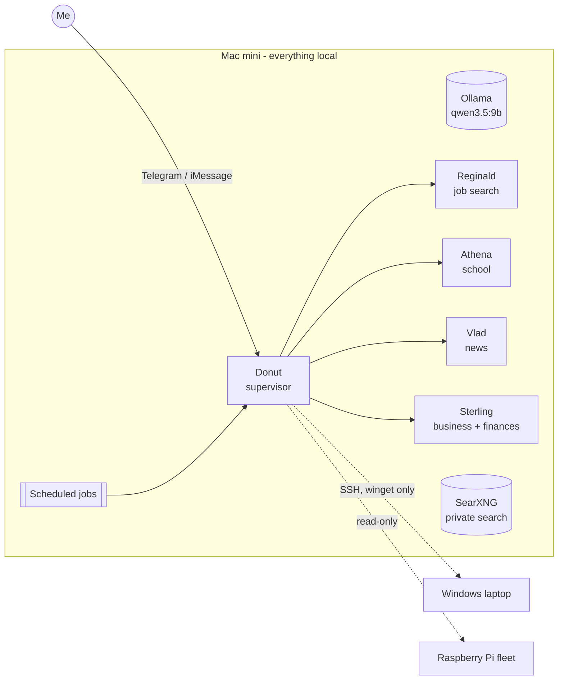

# Home AI Agents

A team of five AI agents that run my day-to-day life admin from a **Mac mini at home**, on a **local
model** (Ollama, `qwen3.5:9b`) through the open-source [Hermes Agent](https://github.com/NousResearch/hermes-agent)
framework. I talk to them on Telegram and iMessage; they run scheduled jobs on their own and report back.

This repo is the **tooling I built around them**: the scripts each agent runs, the installers, and the
guardrails that keep a small local model safe to give real work to. Personal data, credentials and
the agents' memories are not in here (see [SECURITY.md](SECURITY.md)).



## The agents

| Agent | Job | Highlights |
|---|---|---|
| **Donut** | Supervisor + personal assistant | Morning standup (calendar, email triage, fleet health), website watcher, iMessage alerts, timed reminders, dynamic-DNS check, Windows laptop updates over SSH, travel assistant |
| **Reginald** | Job search | Pulls real openings from employers' Workday/Greenhouse/Lever/Ashby systems + JobSpy, ranks them against my résumé, tracks applications and follow-ups |
| **Athena** | School | Files every reading/upload into a per-course library, transcribes lecture recordings locally (MLX Whisper), keeps a deadline planner, quizzes me for oral exams |
| **Vlad** | News | Daily briefs, emailed to a recipient list |
| **Sterling** | Business + finances | Plain-text double-entry books (Beancount + Fava): statement import, auto-categorizing, budgets, bill reminders, rental and side-business P&L, monthly report |

## What's in here

```
agents/
  donut/        digest.py (morning standup) · sentinel.py (web watcher) · inbox_triage.py · calendar_feed.py
                textme.py (iMessage alerts, hard-locked to one number) · reminders.py · duckdns.py
                email_plan.py · laptop.py + windows/ (SSH setup for a Windows laptop) · audit_facts.py (nightly audit)
                model_scorecard.py (which model does the job best, from real conversation history)
  reginald/     job_scout.py · jobspy_fetch.py · tracker.py · job_scout_config.example.json
  athena/       school.py (library + search) · school_sync.py · planner.py · study.py · today.py · make_doc.py
  vlad/         send_brief.py
  sterling/     fin_tool.py · install_finance.sh · finances-template/ (Beancount books, rules, budgets)
tools/
  ai/           install_ai_tools.sh (SearXNG, MLX Whisper, Docling, JobSpy) · transcribe.py · docread.py
  travel/       trip_tools.py (trip calendar .ics, live flight watch, weather, FX, holidays, transit directions)
  privacy/      eraser_job.py (automated data-broker opt-out rounds every 90 days)
skills/
  text-me/      a Hermes skill teaching the agent to text me
```

## Design choices worth calling out

- **Scripts do the work, the model decides when.** A 9B local model is unreliable at multi-step tool use,
  so anything that must be right (parsing, math, dedupe, scheduling, sending) is a small tested script with
  a one-line interface. The agent's instructions just say which command to run.
- **Silent unless there's news.** Scheduled jobs print nothing when all is well, so Telegram only lights up
  when something needs me.
- **Hard limits in code, not just in prompts.** The texting script can only ever reach one number; the laptop
  tool can only run winget and restart; the finance tool can't touch a bank. Prompt rules are a second layer.
- **Read-only by default.** Email triage, school portal, rental portal, finances and the web watcher only read.
  Anything that spends money, submits, signs or messages someone else needs me in the loop.
- **Everything local.** Model, search engine (SearXNG), speech-to-text and document parsing all run on the Mac.
- **Verify before claiming.** Every installer self-tests; the nightly audit checks that files an agent says it
  wrote actually exist.

## Running it

These scripts expect the [Hermes Agent](https://github.com/NousResearch/hermes-agent) layout (`~/.hermes`,
profiles per agent) on macOS (Apple Silicon). Each `install_*.sh` sets up its own Python venv, self-tests,
and registers its scheduled jobs with `hermes cron`. Copy `*.example.json` files and fill in your own details.

Built with a lot of help from Claude.

License: MIT
